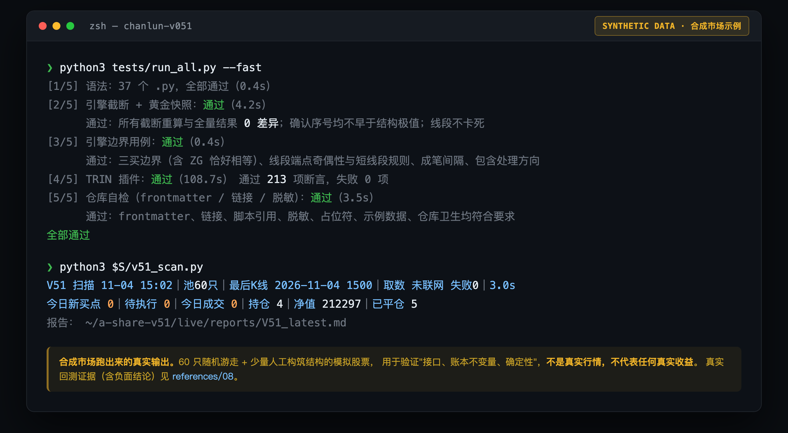
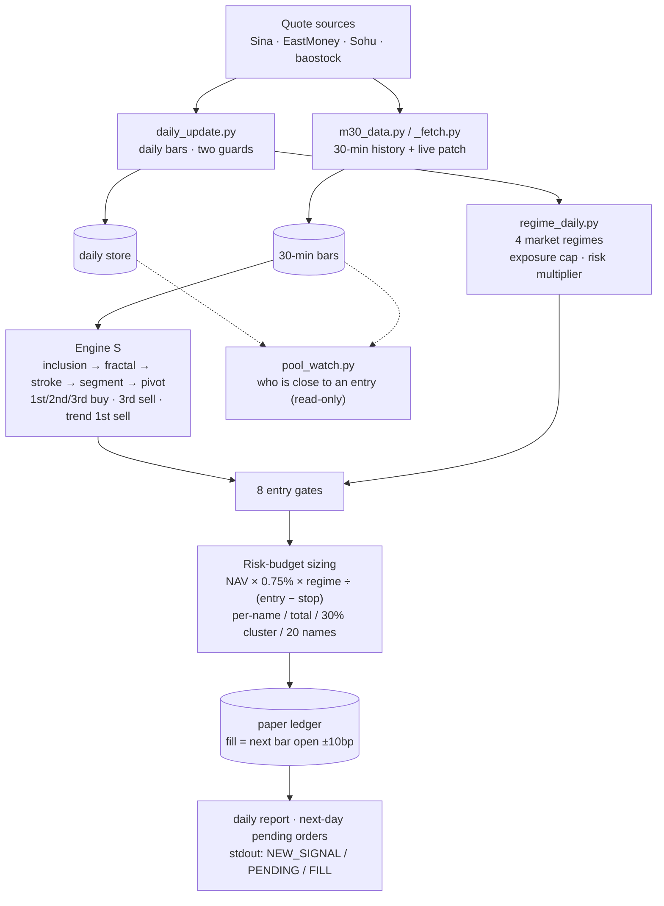
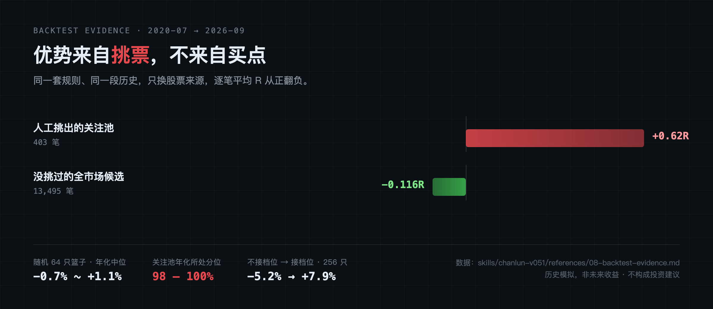

<div align="center">

# chanlun-v051

**Mechanises Chan-theory (缠论) buy/sell points on an A-share watchlist — reproducible, look-ahead-free, paper-ledger only, evidence published.**

A 30-minute *segment* engine (fractal → stroke → segment → pivot → entries) plus a complete trading system and a live paper-trading toolkit.<br>
It is also an **Agent Skill** an AI assistant can load directly.

[中文](README.md) · [English](README.en.md) · [Disclaimer](DISCLAIMER.md) · [Changelog](CHANGELOG.md) · [Architecture](docs/architecture.md)

[](https://github.com/lbh-banboo/chanlun-v051/actions/workflows/ci.yml)

%20%C2%B7%203.10%20verified-blue)


</div>



*(CLI output is in Chinese — the tools are built for China A-share data. The screenshot shows the real, unedited output of the two commands below, run against a synthetic market.)*

> **Research only. Not investment advice. No brokerage integration — every fill is a paper-ledger entry.**
> The evidence does **not** support "the entry signals themselves have an edge". What this repo offers is
> reproducibility, no look-ahead, clear risk controls and honest validation — **not profitability**.
> Full evidence and limitations: [**The honest boundary**](#the-honest-boundary) and [`references/08`](skills/chanlun-v051/references/08-backtest-evidence.md).

## 2-minute self-check (offline, no market data needed)

```bash
git clone https://github.com/lbh-banboo/chanlun-v051.git && cd chanlun-v051
pip install pandas numpy

python3 tests/run_all.py --fast     # ~2 min, fully offline
```

You should see what the screenshot above shows: 37 `.py` files compile, truncate-and-recompute shows **0 differences**,
the TRIN plug-in passes 213 assertions, and the repo-hygiene scan (links / secrets / frontmatter) is green.
**Whether the entries make money is a separate question — first confirm it at least does not cheat and cannot silently drift.**

## What's inside

| You want… | You get… |
|---|---|
| A **reproducible, look-ahead-free** Chan engine | 30-minute *segment* engine: fractal → stroke → segment → pivot (中枢) → 1st/2nd/3rd buy, 3rd sell, trend 1st sell. Truncate-and-recompute = 0 differences |
| A **complete trading system** around it | 8 entry gates, 4 market regimes (+ a "hard" retreat clause), risk-budget position sizing, account circuit-breakers, 30 % theme-cluster cap |
| **Live paper trading** | Every 30-min bar: scan → paper fills / positions / exits / signal-latency log → daily report + next-day pending orders with 9:25 cancel conditions |
| A **stock-selection pipeline** | 9-gate funnel; Shenwan-L1 **quality ranking** (scoring, red flags, back-fill); focus-pool generator; price-ceiling gate (1.5a); pool-file contract + validator |
| **Scheduled tasks** | 6 task templates (intraday ×3, close report, focus-pool ×2) and a plain-`cron` variant |
| **Data hygiene** | Two guards on the daily-bar updater, truncation detection/repair for 30-min history, coverage guard on the regime file |
| **Honest backtest evidence** | Before/after engine-fix comparison, random baskets, full-market control, concentration, acceptance gates, evidence review of the regime rule |
| **Post-mortems** | 16 real incidents/pitfalls: symptom → root cause → fix → how to avoid |

## How it fits together



> Every "gate" traces back to a real incident or a backtest finding — none are decorative.
> Why it is shaped this way: [docs/architecture.md](docs/architecture.md).

## Core rules (summary)

| Item | Rule |
|---|---|
| Universe | Pool file only; listed ≥250 days, 20-day avg turnover ≥ ¥100 M, non-ST, trading |
| Entries | 3rd buy (main), 1st buy (trend divergence), 2nd buy (whether or not it breaks the 1st); **consolidation-divergence candidates are not traded** |
| Timing | Confirm on a closed 30-min bar → buy at the next bar's open; cancel if gap-up >3 %, limit-up, or open ≤ stop |
| Size | NAV × 0.75 % × regime multiplier ÷ (entry − stop), lot-rounded; then capped by per-name / total exposure / 30 % cluster / 20 names |
| Stop | Structure low × 0.99, **never moved**; triggered by a 30-min **close** below it |
| Exits | Stop / 3rd sell / trend 1st sell / 120 trading days — first to fire; T+1 and limit-down roll-over |
| Regimes | Healthy 70 % · Hot 50 % · Repair 40 % · Ebb 20 % · Hard 0 % (no new entries) |
| Breakers | 5 straight losses → pause 5 days; 10 % drawdown → pause new entries; 12 % → freeze; unit NAV ≤ 0.70 → retire |

## Running it for real

**No market data is bundled** — it is large, and it is your data anyway.

```bash
export V51_HOME=~/a-share-v51
S=skills/chanlun-v051/scripts
python3 $S/init_workspace.py --home $V51_HOME --nav 200000
```

Then follow [`references/04-setup-and-data.md`](skills/chanlun-v051/references/04-setup-and-data.md) in order:
**daily bars → 30-min history (+ `m30_data.py check`) → pool file → regime → first scan**. Each step documents how to verify itself.

```bash
python3 $S/pool_tool.py check             # pool file must report 0 errors
python3 $S/regime_daily.py --history      # close-of-day regime
python3 $S/v51_scan.py                    # live scan + paper ledger
python3 $S/pool_watch.py                  # read-only: who is close to an entry
```

## The honest boundary



**The edge of these rules comes mainly from *which stocks you pick*, not from the entry points.**

- **Un-picked, full-market candidates**: 13,495 trades averaging **−0.116 R per trade** (95 % interval −0.17 to −0.05).
- **Hand-picked watchlist**: 403 trades at **+0.62 R**. Random 64-name baskets median −0.7 % to +1.1 % annualised, while the watchlist sits at the **98th–100th percentile**. The watchlist was picked **in hindsight** — a large part of the pretty backtest numbers is that.
- **Same-account basis**: watchlist 64 names → 7.4 % annualised, −15.7 % max drawdown, 23 % win rate. Equal-weight buy-and-hold on the same names over a comparable window: ≈23.8 % (drawdown −38 %). **It badly lags buy-and-hold.**
- **Returns ride on a few long trends**: win rate 23–25 %, median trade ≈ −1.06 R. Remove the best 3 trades and the watchlist account drops from ≈+58 % to ≈+6 %.
- **The market-regime rule is the one solid finding**: without it, −5.2 % annualised / −40.1 % drawdown; with it, +7.9 % / −27.0 % (256-name basis, post-fix). **If you use these entries, you must also size by regime.**
- By year, the return concentrates in **2023 (+22.8 %)** and **2025 (+36.9 %)**; other years are roughly flat.

Full tables, methodology, limitations — including *which claims were falsified along the way* — are in
[`references/08-backtest-evidence.md`](skills/chanlun-v051/references/08-backtest-evidence.md).

> Sample stock names, codes, prices and account figures in the docs are **placeholders** and correspond to no real
> position. The only screenshots in this repo come from a **synthetic market** (60 random walks plus a few engineered
> structures) and exist to prove the plumbing and ledger invariants — **not real quotes, not real returns**.

## Use as an Agent Skill

`skills/chanlun-v051/` follows the [Agent Skills](https://agentskills.io/specification) layout (`SKILL.md` + `references/` + `scripts/` + `assets/`).

| Platform | Install |
|---|---|
| Claude Code (user) | `cp -r skills/chanlun-v051 ~/.claude/skills/` |
| Claude Code (project) | `cp -r skills/chanlun-v051 <project>/.claude/skills/` |
| Claude Code plugin | `/plugin marketplace add lbh-banboo/chanlun-v051` then `/plugin install chanlun-v051@chanlun-v051` |
| Claude Desktop / claude.ai | upload the packaged `chanlun-v051.skill` (see below) |
| Any agent that reads SKILL.md | drop `skills/chanlun-v051/` into its skills directory |

`SKILL.md` routes requests to the right chapter and carries ten non-negotiable rules: rules are frozen during the live test; numbers come only from script output; no investment advice; ask before editing the manual or engine; etc.

## Packaging as `.skill`

```bash
cd skills && zip -r ../chanlun-v051.skill chanlun-v051 -x '*/__pycache__/*' '*.pyc'
```

## Tests

`python3 tests/run_all.py` runs, offline and on synthetic data: look-ahead (truncate-and-recompute) + golden snapshot of 40 fixed-seed series; exact-boundary cases (e.g. 3rd-buy pull-back low ≥ ZG, *including equal*); the TRIN plug-in (213 assertions); an end-to-end synthetic market (ledger invariants: NAV identity, cash reconstructable from fills, lot sizes, per-trade risk cap; determinism; pool-entry-time filtering); and a repository hygiene check (SKILL.md spec, links, **secret/PII scan**, placeholders).

The tests were themselves validated by **mutation testing**: 19 deliberate breakages of the engine/constants were all caught (plus one provably equivalent mutant); 19 injected leaks were all caught by the hygiene scan.

## Known limitations

- A **single 6-year window**; two calendar years carry most of the return; 30-min history starts in 2020, so 2015–2020 cannot be validated.
- The watchlist is **hand-picked in hindsight**; on un-picked stocks the signals lose money. The focus pool (picked by fundamentals) is the real out-of-sample test — it needs time.
- A 3-month live test yields ≈ 6 signals — enough to validate **mechanics**, not **edge**.
- Evidence for the "ebb/hard" regime rule is thin; it works as a drawdown-reducing exposure dial, not as a timing signal.
- Several design decisions are **pending the account owner's ruling** (named exceptions, quality-C names, focus-pool wording, cluster mapping…).
- Some data paths rely on third-party public endpoints that may change at any time.

## Contributing · Security · License

See [CONTRIBUTING.md](CONTRIBUTING.md) (engine/rule changes have extra requirements), [SECURITY.md](SECURITY.md). Licensed under [MIT](LICENSE) — and please read the [DISCLAIMER](DISCLAIMER.md).
