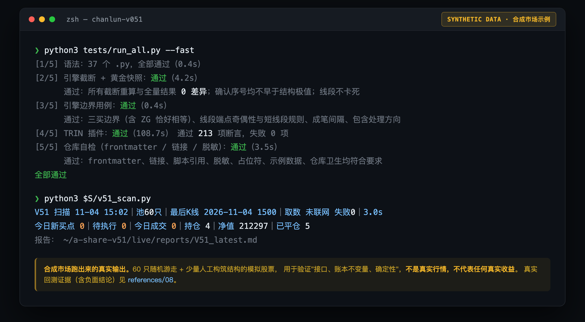
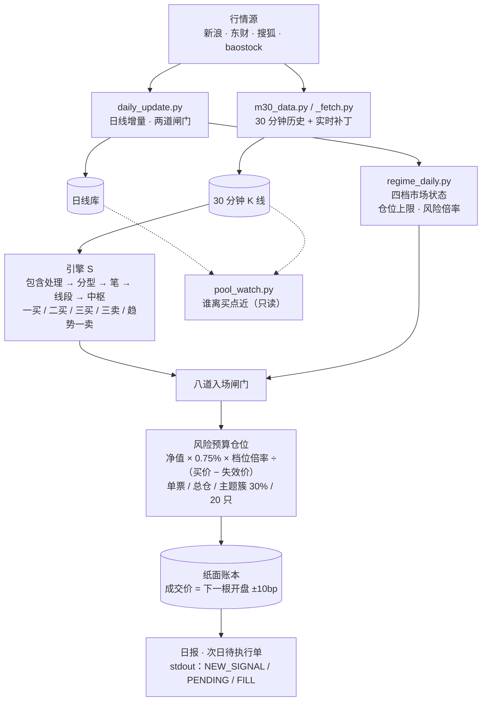
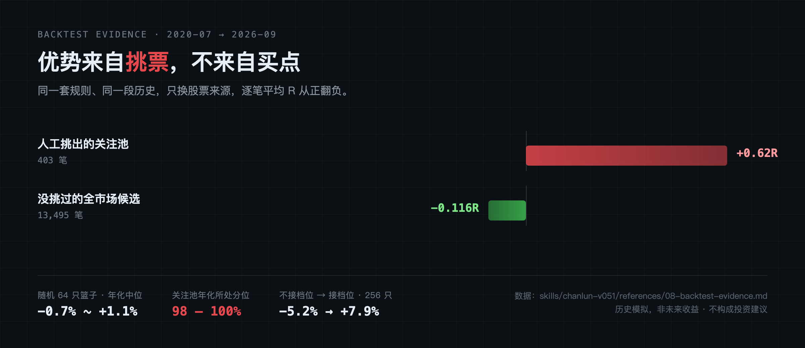

<div align="center">

# chanlun-v051

**把缠论买卖点机械化，跑在 A 股关注池上 —— 规则可复现、无前视、纸面记账、证据公开。**

一套 30 分钟线段引擎（分型 → 笔 → 线段 → 中枢 → 买点），加完整的交易系统与实时纸面回测工具箱，<br>
同时是一个可被 AI 助手直接加载的 **Agent Skill**。

[中文](README.md) · [English](README.en.md) · [免责声明](DISCLAIMER.md) · [更新记录](CHANGELOG.md) · [架构](docs/architecture.md)

[](https://github.com/lbh-banboo/chanlun-v051/actions/workflows/ci.yml)

%20%C2%B7%203.10%20verified-blue)


</div>



> **仅供研究，不构成投资建议；所有成交都是纸面记账，没有券商接口，不会下真单。**
> 回测证据**不支持**"买点本身有优势"——这套东西的价值在于可复现、无前视、验证方法诚实，
> 不在于它能赚钱。完整证据与局限见 [**诚实的边界**](#诚实的边界) 与 [`references/08`](skills/chanlun-v051/references/08-backtest-evidence.md)。

## 2 分钟自检（离线，不需要任何行情数据）

```bash
git clone https://github.com/lbh-banboo/chanlun-v051.git
cd chanlun-v051
pip install pandas numpy

python3 tests/run_all.py --fast     # 约 2 分钟，全部离线，不联网
```

跑完你会看到上面那张图的内容：37 个 `.py` 语法通过、引擎截断重算 **0 差异**、TRIN 插件 213 项断言、
仓库自检（链接/脱敏/frontmatter）全绿。**买点算得对不对先不谈，先确认它至少没前视、没算错。**

## 这是什么

| 你想要… | 这里有… |
|---|---|
| 一套**可复现、无前视**的缠论买卖点引擎 | 30 分钟线段引擎：分型 → 笔 → 线段 → 中枢 → 一买 / 二买 / 三买 / 三卖 / 趋势一卖，截断重算 0 差异 |
| 把买点变成**完整的交易系统** | 八道入场闸门、四档市场状态（含 hard 撤退条款）、风险预算仓位公式、账户熔断、主题簇 30% 上限 |
| **实时跑起来、不下真单** | 盘中每 30 分钟扫描 → 纸面成交 / 持仓 / 平仓 / 信号延迟记录 → 日报 + 次日待执行单 |
| 一套**选股流程**，不只是"找会涨的" | 九道闸门；申万一级行业**质地榜**（打分、红旗、补位）；重点池生成；1.5a 资金可交易性；池文件格式契约与校验 |
| **定时任务**直接可用 | 6 个任务模板（盘中 / 午后 / 收盘 K 线 / 收盘日报 / 重点池 ×2），也可输出 cron 版 |
| 数据**不出错** | 日线增量的两道闸门、30 分钟历史截断检测与修复、档位文件覆盖闸门 |
| **诚实的**回测证据 | 修复前后对照、随机篮子、全市场对照、收益集中度、验收门槛、退潮期规则的证据评估 |
| **踩坑记录** | 16 类常见故障与坑（数据、引擎、定时任务、业务口径、协作）：现象、根因、修法、如何避免 |

## 系统一览



> 每一道"闸门"都对应一次真实事故或一次回测结论，不是拍脑袋加的。为什么长成这样见 [docs/architecture.md](docs/architecture.md)。

### 核心规则（摘要，全文见 [`references/01`](skills/chanlun-v051/references/01-trading-rules.md)）

| 环节 | 规则 |
|---|---|
| 票从哪来 | 只做池里的票；上市满 250 日、20 日均额 ≥1 亿、非 ST、不停牌 |
| 买什么 | 三买（主力）、一买（趋势背驰）、二买（破不破一买都算）；**盘整背驰不开仓** |
| 何时买 | 30 分钟 K 线收盘确认 → 下一根开盘买；高开 >3% / 涨停 / 已破失效价则取消 |
| 买多少 | 净值 × 0.75% × 档位倍率 ÷（买价 − 失效价），取整；再受单票 / 总仓位 / 主题簇 30% / 20 只限制 |
| 止损 | 失效价 = 结构低点 × 0.99，**不移动**；30 分钟**收盘**跌破才算 |
| 卖出 | 失效价 / 三卖 / 趋势一卖 / 持满 120 日，先到先走；T+1、跌停顺延 |
| 档位 | 健康 70% / 高温 50% / 修复 40% / 退潮 20% / hard 0%（禁开新仓） |
| 熔断 | 连亏 5 笔停 5 日；回撤 10% 停新仓；12% 冻结；份额净值 ≤0.70 停用 |

## 真正跑起来

自检通过后再准备数据。**本仓库不附带任何行情数据**（体量大、且是你自己的数据）。

```bash
export V51_HOME=~/a-share-v51
python3 skills/chanlun-v051/scripts/init_workspace.py --home $V51_HOME --nav 200000
```

然后按 [`references/04-setup-and-data.md`](skills/chanlun-v051/references/04-setup-and-data.md) 的顺序：
**补日线 → 下 30 分钟历史并 `check` → 编辑池文件 → 算档位 → 首次扫描**。每一步都写了验证办法。

```bash
S=skills/chanlun-v051/scripts
python3 $S/pool_tool.py check                  # 池文件必须 0 错误
python3 $S/regime_daily.py --history           # 收盘档位
python3 $S/v51_scan.py                         # 实时扫描 + 记账
# 输出里：NEW_SIGNAL = 新买点   PENDING = 下一根开盘待执行单   FILL = 纸面成交
python3 $S/pool_watch.py                       # 只读：现在谁离买点近
```

## 诚实的边界



**这套规则的优势主要来自"挑票"，不是买卖点本身。**

- **没挑过的全市场候选**：13,495 笔，逐笔平均 **−0.116R**（95% 区间 −0.17 到 −0.05）。
- **人工挑出的关注池**：403 笔，**+0.62R**；随机抽 64 只的篮子年化中位 −0.7%～+1.1%，关注池年化排在 **98%—100% 分位**。
  关注池是**事后挑出来的强势票**，回测的漂亮数字有相当一部分是这个带来的。
- **同账户口径**：关注池 64 只年化 7.4%、最大回撤 −15.7%、胜率 23%；同期关注池等权买入持有约 23.8%（回撤 −38%）——**大幅跑输买入持有**。
- **收益靠少数长趋势**：胜率 23%—25%，中位每笔约 −1.06R；去掉最好 3 笔，关注池账户总收益从约 +58% 缩到约 +6%。
- **市场档位是最有把握的一条**：不接档位年化 −5.2%、回撤 −40.1%；接上 +7.9%、−27.0%（256 只口径，修复后）。**用缠论买卖点，必须同时用档位控总仓位。**
- 分年看，收益集中在 **2023（+22.8%）** 和 **2025（+36.9%）** 两年，其余年份接近零。

完整数据、口径、局限、以及"哪些结论被证伪了"全在
[`references/08-backtest-evidence.md`](skills/chanlun-v051/references/08-backtest-evidence.md)。

> 文档里的示例标的名称、代码、价格与账户数值均为**占位示例**，不对应任何真实标的或持仓；
> 回测统计来自历史行情模拟。仓库里唯一的截图来自**合成市场**（60 只随机游走 + 少量人工构筑结构），
> 只用于验证接口与账本不变量，**不是真实行情，不代表任何真实收益**。

## 作为 Agent Skill 使用

`skills/chanlun-v051/` 遵循 [Agent Skills](https://agentskills.io/specification) 目录规范（`SKILL.md` + `references/` + `scripts/` + `assets/`），`name` 与目录名一致，`description` 写明了触发场景。

| 平台 | 安装 |
|---|---|
| Claude Code（个人） | `cp -r skills/chanlun-v051 ~/.claude/skills/` |
| Claude Code（项目） | `cp -r skills/chanlun-v051 <项目>/.claude/skills/` |
| Claude Code 插件市场 | `/plugin marketplace add lbh-banboo/chanlun-v051` → `/plugin install chanlun-v051@chanlun-v051` |
| Claude 桌面版 / claude.ai | 上传打包好的 `chanlun-v051.skill`（见下方"打包"） |
| 其它支持 SKILL.md 的 Agent | 把 `skills/chanlun-v051/` 放进它的 skills 目录 |

装好后，直接对助手说：*"V5.1 的三买是怎么定义的？"*、*"帮我给关注池加一只票"*、*"今天有没有新买点？"*、*"为什么扫描一直没信号？"*、*"生成重点池"*。`SKILL.md` 会把请求分流到对应章节，并带着十条不可违反的纪律（规则冻结、数字只来自脚本输出、不给投资建议、改手册先问用户……）。

## 目录

```text
.
├── README.md / README.en.md            本文件
├── DISCLAIMER.md  LICENSE              免责声明、MIT
├── CHANGELOG.md  CONTRIBUTING.md  SECURITY.md  CODE_OF_CONDUCT.md
├── skills/chanlun-v051/         ◀ Agent Skill 本体
│   ├── SKILL.md                        入口：分流 + 纪律 + 常用命令
│   ├── references/  01…12              规则、引擎、筛选、搭建、池契约、扫描账本、定时任务、回测证据、上线验收、纪律、事故、TRIN
│   ├── scripts/                        引擎、扫描、档位、数据、池工具、质地榜、TRIN
│   └── assets/                         任务模板、cron 示例、示例池/配置、执行卡与质地审查模板
├── tests/                              自检（不联网、合成数据）
├── docs/                               架构与设计说明
└── .github/                            Issue / PR 模板、CI
```

## 测试

```bash
python3 tests/run_all.py          # 全部（约 8–10 分钟；TRIN 健康检查最耗时）
python3 tests/run_all.py --fast   # 跳过端到端，约 2 分钟
```

| 测试 | 它在防什么 |
|---|---|
| `test_engine_truncation.py` | **前视**：数据截到任意时刻重算，已发出的信号必须与全量一致；**规则被悄悄改**：40 条固定种子合成序列的"黄金快照"；**线段卡死缺陷**回归 |
| `test_engine_edges.py` | 三买"回试低点 ≥ ZG（含等于）"这类贴线边界、线段奇偶性与短线段规则、成笔间隔、包含处理方向、账户层常量（单笔风险 0.75%、档位倍率、1.5a、涨跌幅） |
| `test_trin_health.py` | TRIN 插件：合成市场逐项注入异常，213 项断言 |
| `test_pipeline_synthetic.py` | 端到端：init → 日线 → 30 分钟 → 池 → 档位 → 扫描 → 账本不变量（净值恒等式、现金可由流水重建、股数整手、单笔风险上限）→ 池维护 → 任务渲染；含**确定性**与**入池时刻过滤** |
| `test_repo_hygiene.py` | SKILL.md 规范、文档链接、脚本引用、**文档里的每条命令行参数都真实存在**（用 `--help` 探测，保证无副作用）、**脱敏扫描**（通用密钥/路径形态 + 示例池命名契约）、占位符闭合、示例数据 |

这些测试本身也用"**突变检验**"验证过——故意把引擎和常量改坏，看测试能不能发现：还原线段卡死缺陷、制造三种前视、改成笔间隔、改三买边界/中枢 ZG/背驰判据/二买阈值、改仓位与档位常量、把创业板 301 当 10% 涨跌幅……共 19 个有效突变**全部被抓住**；另有 1 个（线段最少笔数 `>=3` 改 `>=2`）经 20 万条随机序列证明是**等价突变**（线段结束端点只可能落在奇数下标，两种写法对任何输入结果相同），不算漏网。第一轮检验曾暴露两处盲区（背驰面积偷看未来、三买贴线边界），已通过扩大黄金快照和增加边界用例补上。仓库自检同样做过植入验证：密钥、令牌、私钥、私有 ID、邮箱、手机号、个人路径、失效链接、非法 name、超长 description、占位符未定义、大文件等泄露/违规，以及 5 种命令行参数错误都能被抓住，合法命令不误报；其中两处（变量名带前缀的密钥赋值、脚本名写错被静默跳过）最初漏过，已修正。自检文件不保存任何作者相关的具体词表，避免「防御性词表」本身成为泄露源。

## 打包为 `.skill`

```bash
cd skills && zip -r ../chanlun-v051.skill chanlun-v051 -x '*/__pycache__/*' '*.pyc'
```

## 参与

欢迎 Issue 与 PR，请先读 [CONTRIBUTING.md](CONTRIBUTING.md)。**引擎行为 / 交易规则相关的改动有额外要求**（预登记、回归测试、更新黄金快照并说明理由）。安全问题见 [SECURITY.md](SECURITY.md)。

## 已知局限（再说一遍）

- 只有**一个 6 年窗口**，2023、2025 两年贡献了大部分收益；30 分钟历史从 2020 年起，**2015—2020 的历史验证段不可检验**。
- 关注池是**事后挑出来的强势票**；没挑过的票上不赚钱。重点池（按基本面挑）的实时结果才是样本外检验，但要等时间。
- 实时回测 3 个月只有约 6 笔信号，**只能验证机制，验证不了策略有没有优势**。
- 退潮期（soft/hard）规则的证据不足，只够当成"降回撤的仓位刻度"，不够当成择时信号。
- 设计里留有若干**待账户所有人裁定**的口径缺口（具名例外、质地 C 的票挡不挡、重点池条文写法、主题簇归簇…），见 [`references/09`](skills/chanlun-v051/references/09-rollout-and-acceptance.md)、[`11`](skills/chanlun-v051/references/11-incidents-and-pitfalls.md)。
- 部分取数依赖第三方公开接口，可能随时改版；质地榜取数依赖需要密钥的第三方服务（可替换，见 [`scripts/quality/SCHEMA.md`](skills/chanlun-v051/scripts/quality/SCHEMA.md)）。

## 许可

[MIT](LICENSE)。请同时阅读 [DISCLAIMER.md](DISCLAIMER.md)。

## 兼容性说明

| 项 | 状态 |
|---|---|
| Python 3.9 / 3.10 / 3.11 / 3.12 | 由 GitHub Actions CI 矩阵**真实运行全套自检**（见 `.github/workflows/ci.yml`）；结果见仓库 Actions 页面 |
| 本机实测 | Python 3.9.6 与 3.11 全套 6/6 通过；代码按 3.9 语法树静态检查通过（无 `X\|Y` 注解、无 `match`、无 `zip(strict=)` 等 3.10+ 特性） |
| macOS | 已在 macOS 验证；`bg_run.py` 在 macOS 上自动套 `caffeinate` |
| Linux | 自检在 Linux 容器内运行通过 |
| Windows | **未验证**。路径处理用 `os.path`，但 `bg_run.py`（`start_new_session`）与 cron 示例是 POSIX 向的，Windows 请用 WSL |
