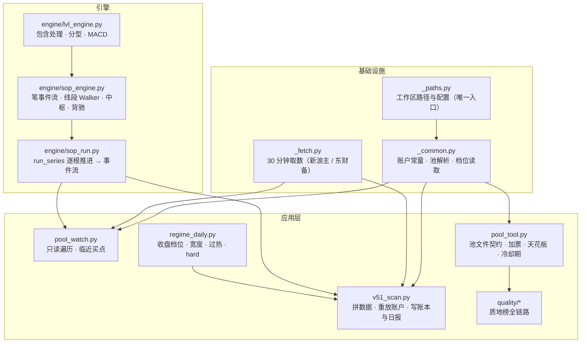

# 架构与设计说明

> 面向想读懂、修改或扩展这套工具的人。使用说明在 [`skills/chanlun-v051/SKILL.md`](../skills/chanlun-v051/SKILL.md) 和 `references/`，这里讲**为什么长成这样**。

## 1. 数据流

```text
                 ┌──────────────── 行情源（新浪 / 东财 / 搜狐 / baostock）────────────────┐
                 │                                                                      │
   daily_update.py ──► data/daily/<代码>.csv ──► regime_daily.py ──► pipeline/regime_YYYYMMDD.json
   (收盘后；两道闸门)     (全市场日线, adj)        (覆盖闸门)            (state_bt, breadth, diag)
                 │                                                                      │
   m30_data.py ───► data/m30/<代码>.csv.gz        data/m30_recent/<代码>.csv             │
   (baostock)        30 分钟历史                    历史末端补丁                          │
                 │                                                                      │
   v51_scan.py ◄─┴── 实时 30 分钟线（新浪主、东财备）──► live/state/m30_ext/<代码>.csv     │
        │                                                                               │
        │  读：pools/watchlist.md（名单、板块、加入日期、主题簇、簇叠加、冷却期）          │
        │  读：pipeline/regime_YYYYMMDD.json ◄─────────────────────────────────────────┘
        ▼
   引擎 run_series(h, l, c, "S")  ──►  事件流 B3/B1/B2c/B2w/S3/S1
        ▼
   逐根重放（simulate）：挂单 → 开盘成交 → 持仓退出判定 → 新买点入单 → 15:00 日终（熔断、净值）
        ▼
   live/state/v51_ledger.json  signals_log.jsonl  live/reports/V51_<日期>.md  V51_latest.md
        ▼
   stdout 协议行：NEW_SIGNAL / PENDING / FILL    ──►  定时任务 / 通知 / 人
```

## 2. 几个关键设计决定及理由

### 2.1 确定性重放，而不是增量状态

`v51_scan.py` 每次运行都**从起点日把全部 30 分钟 K 线整段重放一遍**，而不是维护一份"上次跑到哪里"的状态。代价是每次 5—15 秒的计算；换来的是：
- **漏跑不丢记录**（电脑睡眠、任务被跳过、会话卡住——都会发生）；
- **没有状态漂移**：账本永远等于"这份数据按这套规则的结果"，可以被任意复算、对账；
- 修了数据或引擎之后，重跑即得到修正后的账本（旧账本可备份对比）；
- 代价：不能在重放过程中"手工调整某笔成交"。这是有意的——手工调整会破坏可复现性。

### 2.2 引擎只看已收盘 K 线，事件带"确认序号"

引擎每个事件都带 `avail`（K 线序号，该根收盘后才可用）。分型要右侧 K 线出现才确认，线段要出现更低的底才结束。**任何入场价、失效价、R 都从确认时刻算**，不是从结构极值时刻算——后者（事后版）会把回测夸大 2—9 倍，是软件图上"漂亮买点"的来源。`tests/test_engine_truncation.py` 的核心就是证明这一点。

### 2.3 档位是"前一交易日收盘"，且盘中不改

档位决定总仓位上限与风险倍率。用**前一交易日收盘**档位，盘中不宣布切换，是为了让回测与实时一致（回测里没有盘中档位这一环）。代价是升档晚一天；收益是不会被盘中噪声来回切换。

### 2.4 池文件是 markdown + 正则，而不是 JSON/YAML

池文件同时是**人读的名单和说明**（板块口径、入池来源、冷却期、待裁定清单）和**机器读的输入**。用 markdown 表格意味着人改起来自然，但也意味着格式契约脆弱——所以才有 `pool_tool.py check`，把契约变成可执行的校验。取舍：宁可多一个校验器，也不让人去编辑 JSON。

### 2.5 入池时刻 = 防前视的一等公民

V5.1 规定"入池必须发生在信号之前"。实现：名单表的「加入日期」→ `POOL_FROM`，**入池前确认的买点不计入账本**（仍然记录在 `skips` 里，写明"入池前确认，不计"）。没有这条，新加一只票会让扫描从起点日起回溯给它记账——那就成了"看着走势挑票再补记"。

### 2.6 为什么这么多"闸门"

每道闸门都对应一次真实的事故或一次回测结论：
- 日线更新的**两道闸门** ← 盘中补跑污染全库的事故；
- 档位的**覆盖闸门** ← 用不完整日线写出"修复期、宽度 50%"；
- 30 分钟历史的**截断检测** ← baostock 静默截断；
- **1.5a** ← 一只买不起的票在池里躺了三个月；
- **#57 带宽（买价−失效价 ≥ 近 5 日平均振幅）** ← 示例：同一个失效价下，买在较高的示例价带宽比 1.000，买在更低的示例价只剩 0.185——"买得便宜"反而让止损距离小于日内振幅，被噪声打掉；
- **冷却期（卖出后 3 个交易日不买回）** ← 手册原文：重新进入必须重新满足完整买点，"不因卖出后上涨而当天追回"；回测里这条几乎不起作用（256 只年化 2.8%→2.6%、对照组不变），按事先定的规则继承。
详见 `references/11-incidents-and-pitfalls.md`。

### 2.7 把"助手"与"脚本"分开

定时任务的提示词只做三件事：**跑脚本、读文件、按固定格式汇报**。规则、参数、判定全在脚本里。这样：
- 换助手/换模型不会改变交易结果；
- 改规则不用改提示词；
- 助手即使"想多了"，也无法改变账本（账本是脚本写的）；
- 也可以完全不用助手，直接 cron 跑脚本（`install_tasks.py --crontab`）。
提示词里同时写死了纪律：数字只来自脚本输出、读不到写"报告未提供"、不给投资建议、失败不要自行换数据源。

### 2.8 主要的"不做什么"

- **不下真单**：没有券商接口，也不打算有；
- **不择优**：同一根 K 线多个买点按代码顺序处理（回测是随机顺序，任何择优都没检验过）；
- **不加仓、不分批**：一个买点一次建仓；
- **不用均线卖、不用盘整即退**：回测显示会提前切掉少数长趋势；
- **不为凑收益目标放宽**：研究目标年化 10% **未获支持**，按总则不得为凑目标加大风险；
- **不在实时回测期改规则**。

## 3. 模块职责与依赖



| 模块 | 职责 | 依赖 |
|---|---|---|
| `_paths.py` | 工作区路径、配置读取（唯一入口） | — |
| `_common.py` | 账户常量、池文件解析、档位读取、板块/涨跌幅/天花板 | `_paths` |
| `_fetch.py` | 30 分钟行情取数（新浪主、东财备） | — |
| `engine/lvl_engine.py` | 包含处理、分型、MACD | numpy, pandas |
| `engine/sop_engine.py` | 笔事件流、线段 Walker、中枢/趋势/背驰/买卖点 | lvl_engine |
| `engine/sop_run.py` | `run_series`：逐根推进，产出事件流 | sop_engine |
| `v51_scan.py` | 拼数据、跑引擎、重放账户、写账本与日报 | 上面全部 |
| `pool_watch.py` | 只读遍历（临近买点等） | 同上，复用拼数据逻辑 |
| `regime_daily.py` | 收盘档位（宽度、过热、hard 状态机） | `_paths` |
| `pool_tool.py` | 池文件校验/加票/天花板/冷却期 | `_common` |
| `quality/*` | 质地榜全链路 | 独立，仅 `build_focus_pool` 读 `_common` |

> `pool_watch.py` 里有一份 `analyze2`（与 `sop_engine.analyze` 逐行相同、额外返回中枢列表）和一份"假设进行中线段就在当前极值结束"的前瞻逻辑，用于"临近买点"。它与主引擎**并行存在**是有意的：当年正是靠这条独立代码路径与主路径对账，发现了线段卡死缺陷。`pool_watch.py` 里有断言保证两者事件逐项一致。

## 4. 想扩展？

- **换行情源**：实现 `_fetch.py` 里同样签名的函数（返回 `[(日期, "HHMM", 开, 高, 低, 收, 量, 额)]`，不复权），并保证 K 线时间标签是**结束时刻**。
- **换质地榜数据源**：只要产出 `stocks.json` + `supp.json`（`scripts/quality/SCHEMA.md`），第 3 步之后全部照常。
- **加一个池**：复制 `v51_scan_focus.py` 的包装法（设置 `V51_POOL_FILE / V51_CFG / V51_TAG / V51_LABEL`），改前先备份、改后用"回放前后账本逐字段对比"做回归。
- **改规则**：见 [CONTRIBUTING.md](../CONTRIBUTING.md) 第 3 类改动的全部要求。
